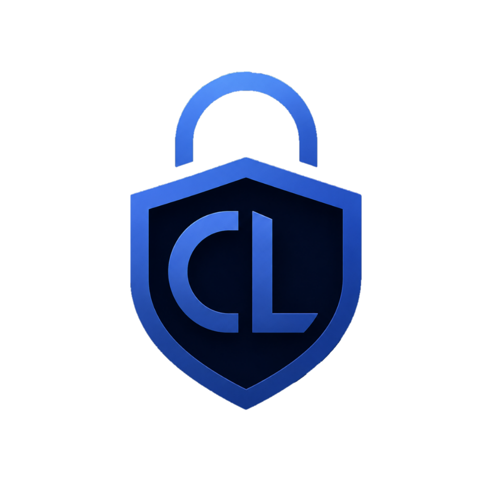

<p align="center">
  
</p>

<h1 align="center">CrypticLocker</h1>

<p align="center">
  <strong>A secure, offline-first personal vault for protecting your private files and folders.</strong>
</p>

<p align="center">
  No cloud. No accounts. No telemetry. Your files stay on YOUR machine.
</p>

<p align="center">
  <a href="https://github.com/vipmayank2-design/CrypticLocker/releases"></a>
  <a href="https://github.com/vipmayank2-design/CrypticLocker/releases"></a>
  <a href="LICENSE"></a>
  <a href="https://github.com/vipmayank2-design/CrypticLocker/actions"></a>
</p>

<p align="center">
  <a href="#features">Features</a> •
  <a href="#download">Download</a> •
  <a href="#security">Security</a> •
  <a href="#build-from-source">Build</a> •
  <a href="#contributing">Contribute</a> •
  <a href="#license">License</a>
</p>

---

## What is CrypticLocker?

CrypticLocker is a free, open-source desktop application that lets you encrypt and protect your private files and folders inside a secure personal vault. Everything runs **locally on your machine** — no internet connection required, no cloud storage, no accounts, no data ever leaves your computer.

Built with **AES-256-GCM** encryption and **scrypt** key derivation, the same cryptographic standards used by security professionals worldwide.

---

## Features

### 🔒 Military-Grade Encryption
- **AES-256-GCM** authenticated encryption with per-file unique IVs
- **scrypt** password hashing (N=16384, r=8, p=1) — resistant to brute-force and GPU attacks
- 256-bit recovery key for emergency vault access

### 📁 File & Folder Management
- Add files and folders with **Copy** (keep original) or **Move** (migrate to vault) modes
- Restore files back to their original location
- Bulk operations — select multiple items at once
- Real-time search and column sorting

### 📦 Capsule Engine — Secure Sharing (.clpack)
- Export individual files or folders as encrypted **capsule packages**
- Share `.clpack` files with anyone — they open in CrypticLocker with a password
- Multi-item capsule bundles for sharing multiple files at once
- Import capsules and merge into your existing vault

### 💾 Full Vault Backup (.clvault)
- Export your entire vault as a single encrypted backup archive
- Restore from `.clvault` backups on any machine with CrypticLocker
- Pre-check disk space validation before export/import

### ⚡ Adaptive I/O Acceleration
- Hardware-aware dynamic buffer scaling (512 KB to 16 MB based on your system RAM)
- Up to **~600% throughput** improvement for large file operations
- Interactive acceleration tier selection

### 🛡️ Security Hardening
- Progressive lockout after failed password attempts (exponential cooldown)
- Auto-lock on idle timeout and OS sleep/screen-lock events
- Quarantine system for detecting and recovering orphaned encrypted files
- Vault integrity checking

### 🎨 Clean Interface
- Dark, Light, and System theme support
- Custom glassmorphic tooltips — zero native browser tooltips
- Professional, distraction-free design

### 💻 Cross-Platform
- **Windows**: NSIS installer + portable edition (USB-ready, zero install)
- **macOS**: DMG for Apple Silicon (M1/M2/M3/M4) and Intel
- **Linux**: AppImage (universal) and .deb (Debian/Ubuntu)
- Native file associations for `.clvault` and `.clpack`

---

## Download

### Latest Release
Download the latest version from the [**Releases**](https://github.com/vipmayank2-design/CrypticLocker/releases) page.

| Platform | Download | Type |
| :------- | :------- | :--- |
| **Windows** | `CrypticLocker Setup X.X.X.exe` | Installer |
| **Windows** | `CrypticLocker X.X.X.exe` | Portable (no install) |
| **macOS** | `CrypticLocker-X.X.X.dmg` | DMG |
| **Linux** | `CrypticLocker-X.X.X.AppImage` | AppImage |
| **Linux** | `CrypticLocker_X.X.X_amd64.deb` | Debian package |

### Portable Edition
The portable `.exe` runs directly from a USB drive or any folder — no installation, no registry changes, no traces left behind.

---

## Security

### Encryption Architecture

```
              [ Master Password ]
                      │
                      ▼
        [ scrypt KDF (N=16384, r=8, p=1) ]
                      │
                      ▼
            [ Password Unlock Key ]
                      │
                      ▼
    ┌───────────────────────────────────────┐
    │  Vault Master Key (VMK) Decryption   │
    │          AES-256-GCM                 │
    └───────────────────────────────────────┘
                      │
                      ▼
             [ Vault Master Key ]
                      │
                      ▼
    ┌───────────────────────────────────────┐
    │   Per-File Streaming Encryption      │
    │   • Unique 96-bit IV per file        │
    │   • 128-bit GCM auth tags            │
    │   • Hardware-aware buffer scaling    │
    └───────────────────────────────────────┘
```

### Key Facts
- **Zero-knowledge**: Your master password is never stored anywhere
- **Zero-telemetry**: No data, analytics, or crash reports are ever sent
- **Offline-first**: Works completely without internet
- **Open-source**: Full source code available for audit
- All crypto uses Node.js built-in `crypto` module — no third-party crypto libraries

For the full security policy and vulnerability reporting, see [SECURITY.md](SECURITY.md).

---

## Build from Source

### Prerequisites
- [Node.js](https://nodejs.org/) v20.x or v22.x (recommended: v22.x)
- npm v10.x or higher
- Git

### Setup

```bash
# Clone the repository
git clone https://github.com/vipmayank2-design/CrypticLocker.git
cd CrypticLocker

# Install dependencies
npm install

# Run in development mode
npm start

# Run the test suite (16 test suites)
npm test
```

### Build Binaries

```bash
# Windows (NSIS installer + portable)
npm run build:win

# macOS (DMG for Apple Silicon & Intel)
npm run build:mac

# Linux (AppImage + .deb)
npm run build:linux
```

Build output is in the `dist/` directory.

---

## Project Structure

```
CrypticLocker/
├── .github/
│   └── workflows/
│       ├── ci.yml                  # Test on every push & PR
│       ├── build.yml               # Multi-platform build
│       └── release.yml             # Auto-release on tag push
├── core/
│   ├── capsule/
│   │   └── capsulePackage.js       # .clpack capsule engine
│   ├── constants/
│   │   └── cryptoConstants.js      # Cryptographic parameters
│   ├── crypto/
│   │   └── vaultCrypto.js          # AES-256-GCM cipher engine
│   ├── session/
│   │   └── sessionManager.js       # Session & auto-lock state
│   └── vault/
│       └── vaultPackage.js         # .clvault export/import engine
├── src/
│   ├── css/                        # Stylesheets (dashboard, global, login)
│   ├── fonts/                      # Bundled typography (zero CDN)
│   ├── img/                        # Icons and logos
│   ├── js/                         # Renderer scripts
│   ├── dashboard.html              # Main vault interface
│   └── index.html                  # Login & setup interface
├── main.js                         # Electron main process & IPC
├── preload.js                      # Context bridge security layer
├── test-all.js                     # 16 automated test suites
├── package.json                    # Build config & metadata
├── LICENSE                         # GPL-3.0
├── CONTRIBUTING.md                 # Contribution guide
├── SECURITY.md                     # Security policy
├── CHANGELOG.md                    # Version history
└── CODE_OF_CONDUCT.md             # Community guidelines
```

---

## Tech Stack

| Component | Technology |
| :-------- | :--------- |
| Framework | [Electron](https://www.electronjs.org/) 40.x |
| Runtime | [Node.js](https://nodejs.org/) 22.x |
| Encryption | Node.js `crypto` (AES-256-GCM + scrypt) |
| Build | [electron-builder](https://www.electron.build/) |
| CI/CD | [GitHub Actions](https://github.com/features/actions) |
| Typography | [League Spartan](https://www.theleagueofmoveabletype.com/league-spartan) (bundled) |

---

## Contributing

Contributions are welcome! Please read our [Contributing Guide](CONTRIBUTING.md) before submitting a pull request.

### Quick Start
1. Fork the repository
2. Create a feature branch: `git checkout -b feature/my-feature`
3. Make your changes and ensure all 16 tests pass: `npm test`
4. Submit a pull request

### Security Issues
**Do NOT open public issues for security vulnerabilities.** Please follow our [Security Policy](SECURITY.md) for responsible disclosure.

---

## License

CrypticLocker is free and open-source software licensed under the [GNU General Public License v3.0](LICENSE).

You are free to use, modify, and distribute this software. If you distribute modified versions, they must also be open source under the same license.

---

## Acknowledgments

- [Electron](https://www.electronjs.org/) — Cross-platform desktop framework
- [Node.js](https://nodejs.org/) — Runtime with built-in cryptographic primitives
- [electron-builder](https://www.electron.build/) — Build and packaging toolchain
- [League Spartan](https://www.theleagueofmoveabletype.com/league-spartan) — Beautiful open-source typeface

---

<p align="center">
  Made with 🛡️ for privacy
</p>
